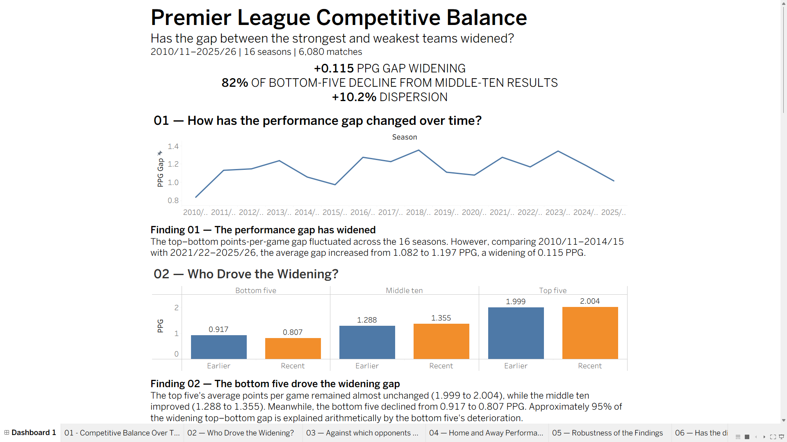

# Premier League Competitive Balance Analysis

**An end-to-end sports analytics project using Python, SQL and Tableau | 2010/11–2025/26**

[**View Interactive Tableau Dashboard**](https://public.tableau.com/app/profile/cameron.sullivan.davis/viz/Premier_League_Competitive_Balance/Dashboard1)

## Project Overview

Has the Premier League become less competitive, and if so, which teams are driving the change?

This project investigates competitive balance across 16 Premier League seasons (2010/11–2025/26), analysing 6,080 matches to understand how performance differences between teams have evolved.

Rather than relying solely on league tables or championship outcomes, the analysis examines points per game (PPG), opponent-level performance, home and away results, alternative team groupings and league-wide performance dispersion.

The objective was to develop a reproducible analytical workflow, test whether the initial findings were robust, and communicate the results through an interactive Tableau dashboard.

## Key Findings

**1. The gap between the strongest and weakest teams has widened.**

The average PPG difference between top-five and bottom-five teams increased from 1.082 in 2010/11–2014/15 to 1.197 in 2021/22–2025/26, representing an increase of approximately 10.6%.

**2. The widening was driven primarily by declining bottom-five performance.**

Across the two comparison periods:

| Performance group | Earlier PPG | Recent PPG |
|---|---:|---:|
| Top five | 1.999 | 2.004 |
| Middle ten | 1.288 | 1.355 |
| Bottom five | 0.917 | 0.807 |

Top-five performance remained relatively stable, while bottom-five teams experienced a decline of approximately 0.11 PPG.

**3. Bottom-five teams lost ground particularly against middle-ten opponents.**

Their PPG against middle-ten opposition fell from 0.992 to 0.822. This contributed substantially to their overall decline, suggesting the deterioration was not confined to matches against the league's strongest teams.

**4. Home advantage against top-five opponents weakened for bottom-five teams.**

Bottom-five home PPG against top-five opponents declined from 0.600 to 0.392, while their away performance changed comparatively little. Heavy home defeats against these opponents also became more frequent.

**5. Alternative team groupings supported the wider conclusion.**

Sensitivity analysis tested whether the widening was dependent on the original top-five and bottom-five definitions. The alternative groupings provided additional evidence that the result was not simply an artefact of one classification choice.

**6. League-wide performance dispersion increased.**

The standard deviation of team-season PPG increased from approximately 0.429 to 0.473, representing an increase of around 10.2%.

This provides a complementary measure of competitive imbalance beyond comparisons between selected team groups.

## Tools and Analytical Workflow

### Python — Data Collection and Validation

Python was used to acquire historical match data, inspect dataset structure, perform quality checks and conduct sensitivity analysis.

The workflow included checking data consistency and preparing the underlying information for subsequent analysis.

### SQL — Analytical Modelling

SQL was used to structure and aggregate match results, calculate points-per-game metrics, segment teams by league position and compare performance between periods.

The analytical process involved conditional aggregation, joins, grouping and common table expressions (CTEs).

### Tableau — Data Visualisation

Tableau was used to develop an interactive, six-finding dashboard presenting the results and accompanying interpretation.

The dashboard combines trend analysis, performance-group comparisons, opponent-level breakdowns, home-and-away analysis, sensitivity testing and distributional measures.

## Methodology

**Data source:** [Football-Data.co.uk](https://www.football-data.co.uk/englandm.php)

**Coverage:** 16 Premier League seasons, 2010/11–2025/26 (6,080 matches).

**Comparison periods:**
- Earlier: 2010/11–2014/15
- Recent: 2021/22–2025/26

**Performance groups:** Teams were ranked within each season by match-earned points, then goal difference and goals scored, before being divided into performance groups.:
- Top five: positions 1–5
- Middle ten: positions 6–15
- Bottom five: positions 16–20

**Primary measure:** Points per game (PPG), calculated as points earned divided by matches played.

The analysis compares performance between defined periods and examines whether the observed changes remain consistent across different measures and grouping choices.

## Validation and Sensitivity Analysis

To improve confidence in the findings, the project included:

- Data quality and consistency checks during preparation.
- Cross-validation of analytical results using Python and SQL.
- Checks on match totals and aggregated performance metrics.
- Sensitivity analysis using alternative performance-group definitions.
- Comparison of the primary group-level findings with league-wide dispersion measures.

These checks were intended to identify calculation errors, assess the dependence of the results on methodological choices and avoid relying on a single indicator.

## Limitations

This is a descriptive, observational analysis rather than a causal study.

Several limitations should be considered:

- Team group membership changes between seasons, so the analysis measures performance by league position rather than following a fixed set of clubs.
- Earlier-versus-recent comparisons may be sensitive to the selected periods.
- PPG and dispersion capture important dimensions of competitive balance but do not measure every aspect of league competitiveness.
- The analysis does not establish the causes of widening performance differences, such as financial resources, recruitment strategies or tactical developments.

Further research could incorporate club finances, wage expenditure and transfer spending to investigate potential explanatory factors.

## Repository Structure

- **`python/`** — Data acquisition, inspection and sensitivity analysis scripts.
- **`sql/`** — Analytical queries, aggregations and validation.
- **`tableau/`** — Tableau workbook and dashboard materials.
- **`README.md`** — Project overview, findings and methodology.

The scripts and workbook document the analytical approach. Reproducing the complete workflow may require downloading the source data and configuring local file paths and database connections.

## How to Reproduce

### Prerequisites

- Python 3.10 or newer
- pandas 2.0 or newer
- NumPy
- MySQL and MySQL Workbench for the SQL analysis
- Tableau Desktop or Tableau Public Edition for viewing the workbook
- Internet access to download the original match data

### 1. Clone the Repository

```bash
git clone https://github.com/Magnolia-bit/premier-league-competitive-balance.git
cd premier-league-competitive-balance
```

### 2. Install Python Dependencies

```bash
python -m pip install "pandas>=2.0" numpy
```

The download script uses Python's standard library. pandas and NumPy are required by the analytical scripts.

### 3. Download the Original Data

```bash
python python/download_seasons.py
```

Downloads Premier League match results for the 2010/11–2025/26 seasons from Football-Data.co.uk.

The script saves the original CSV files inside `python/` and generates `source_manifest.csv`, containing source URLs, retrieval timestamps where recorded, and SHA-256 checksums.

Existing source files are not automatically downloaded again.

### 4. Inspect and Process the Data

Optional initial inspection of the 2010/11 season:

```bash
python python/inspect_season.py
```

Run the complete 16-season analysis:

```bash
python python/analyse_seasons.py
```

The main analytical script:

- Validates season-level fixtures, results, goal values and match dates.
- Reconstructs team-level match records and league tables.
- Calculates points per game, performance-group classifications and opponent-level statistics.
- Compares the earlier (2010/11–2014/15) and recent (2021/22–2025/26) periods.
- Exports the analytical datasets to `python/results/`.

### 5. Run Sensitivity Analysis

```bash
python python/sensitivity_analysis.py
```

This script reads `python/results/fixtures.csv` and performs five robustness checks:

1. Alternative top-five/bottom-five and top-four/bottom-four groupings.
2. League-wide PPG dispersion.
3. Home-versus-away performance against different opponent groups.
4. Trend comparisons excluding the 2019/20 and 2020/21 pandemic seasons.
5. Sensitivity to official points deductions in 2023/24.

The resulting CSV files are saved to `python/results/`.

### 6. SQL Analysis

The `sql/` folder contains the queries used for additional analytical calculations and validation in MySQL.

To reproduce the SQL stage, create a local MySQL database, import the relevant generated CSV datasets, and execute the queries in their required dependency order.

The exact SQL table definitions and execution sequence still need to be documented and independently tested.

### 7. Tableau Dashboard

Open the `.twbx` packaged workbook in the `tableau/` folder to view the dashboard with its saved data extracts.

To refresh the dashboard using regenerated analysis results, reconnect the relevant data sources to their corresponding updated outputs and refresh the extracts.

[**View the Published Interactive Dashboard**](https://public.tableau.com/app/profile/cameron.sullivan.davis/viz/Premier_League_Competitive_Balance/Dashboard1)

### Reproducibility Status

The Python execution order, external imports and file dependencies have been reviewed. A complete clean-environment reproduction, including the MySQL and Tableau refresh stages, has not yet been independently verified.

## Project Ownership and AI Assistance

I directed this project, from defining the research questions and assessing the methodology to testing the code, cross-checking results in Python and SQL, interpreting the findings and building the final Tableau dashboard.

I used ChatGPT to support code generation, debugging, technical guidance, dashboard development and analytical review, and to help draft the README and methodology documentation. I reviewed the outputs and took responsibility for the final analysis and conclusions.

## Project Outcome

The project demonstrates an end-to-end analytics workflow, from data acquisition and quality checks to analytical modelling, sensitivity testing and communication of findings.

The central conclusion is that Premier League performance inequality has increased across the periods examined, with declining results among bottom-five teams explaining much of the widening gap.

The analysis also illustrates the importance of investigating *why a metric has changed*, validating findings across alternative approaches and recognising the limitations of descriptive analysis.
